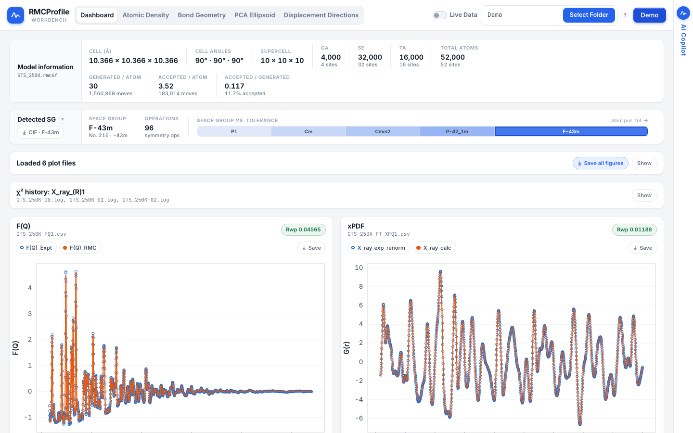
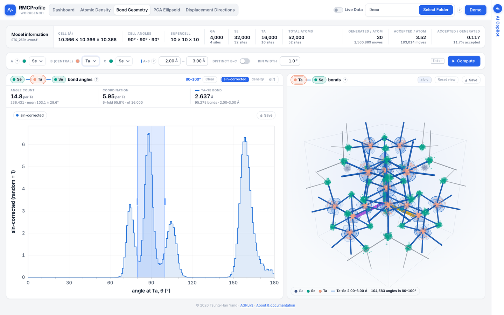
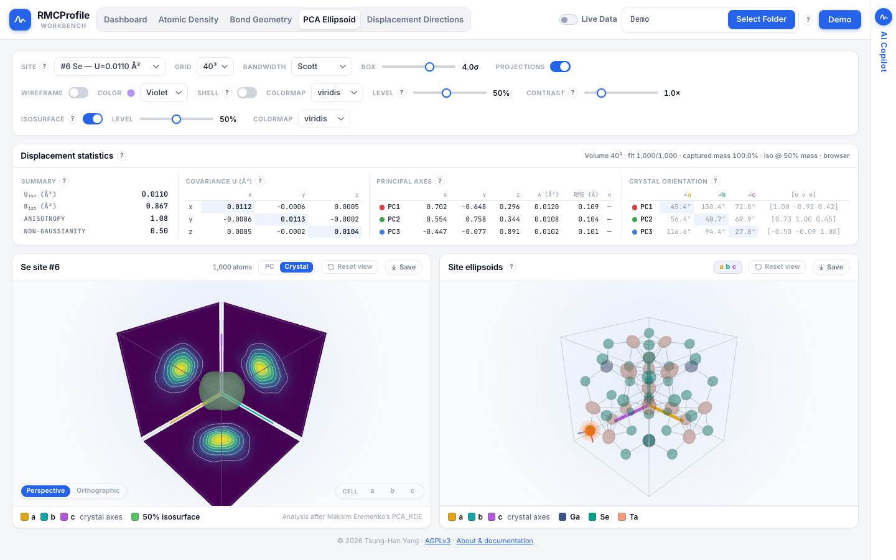
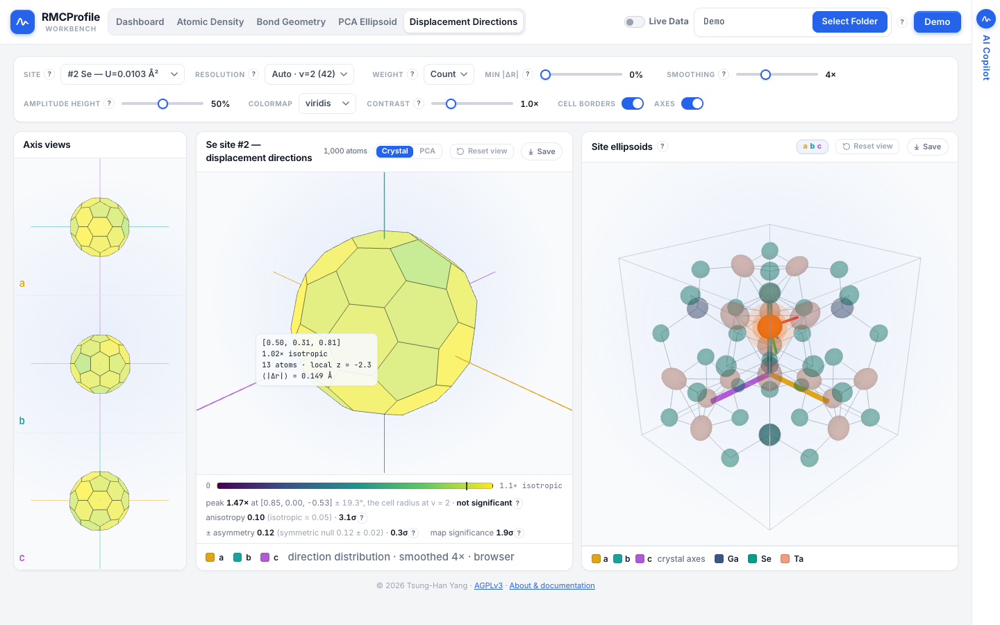
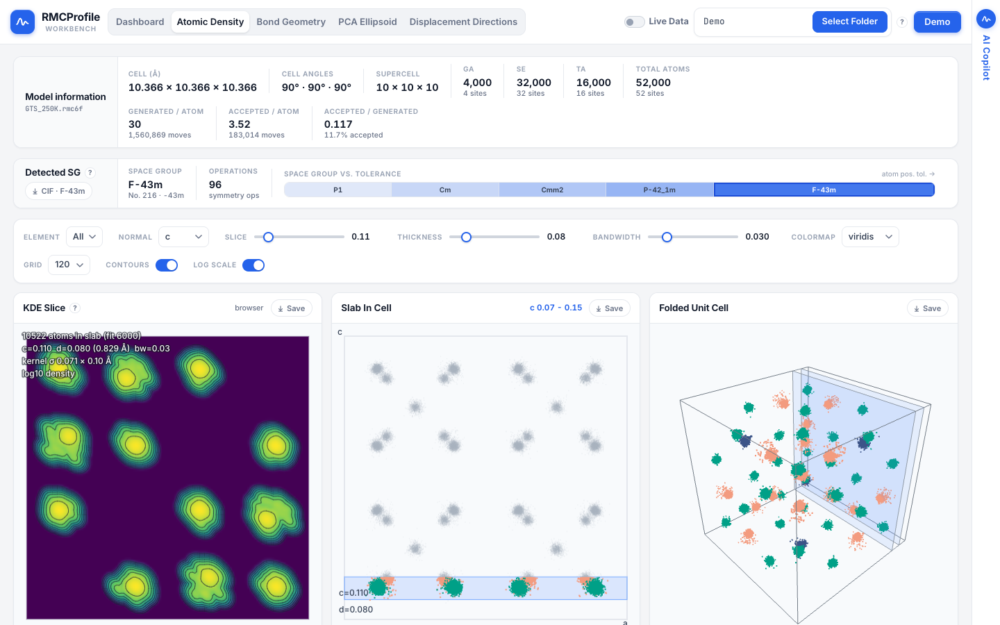
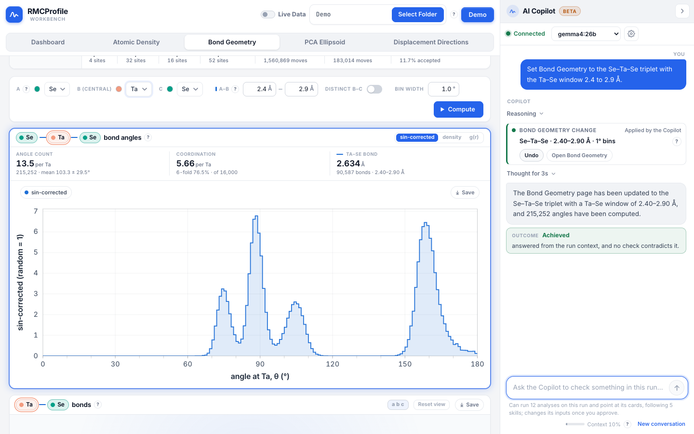

# QuickStart

The RMCProfile Workbench (`rmc-toolkits`) is an interpretation workbench for RMCProfile runs: open a
run folder to judge the fit, read the local structure (bond angles, thermal ellipsoids,
displacement directions, atomic density, symmetry) and decide the next analysis or the next RMC
run. This guide covers version 0.8.0.

## 1. Open The Hosted App

Go to:

[https://drthyang.github.io/rmc-toolkits/](https://drthyang.github.io/rmc-toolkits/)

- Press `Demo` to load the bundled example run (GaTa₄Se₈ at 250 K, 52,000 atoms). Press it again
  to leave the Demo.
- Or click `Select Folder` and choose a local RMCProfile run folder. Your files stay on your
  machine: they are read in the browser and never uploaded.

The pages work on desktops, iPads and phones, in both orientations.

## 2. Use A Run Folder

A typical folder contains files like:

```text
sample.rmc6f
sample-01.log
sample_FQ1.csv
sample_SQ1.csv
sample_FT_XFQ1.csv
sample_PDFpartials.csv
sample_bragg.csv
Nb-EXAFS-1_Q_OUTPUT.csv
Nb-EXAFS-1_R_OUTPUT.csv
```

After loading, use the pages:

- `Dashboard` to judge the fit: `Model information` (cell, supercell, atoms per element, moves
  generated and accepted), the `Detected SG` card, the χ² history and one plot per fit file with
  its Rw. Hover for readouts, drag to zoom, `Show`/hide a chart, and save a plot as PNG or SVG or
  all of them as a ZIP (`Save all figures`).
  - `Detected SG` names the space group the configuration keeps and how it changes with the
    tolerance: the `Space group vs. tolerance` ladder runs from the tightest tolerance (often P1)
    to the loosest (the Demo: P1, Cm, Cmm2, P-42₁m, F-43m). Click a rung to pick it; the
    `CIF` button downloads the average structure in the picked group (e.g.
    `GTS_250K_F-43m.cif`).
- `Atomic Density` for KDE density slices of one element or all, a `Slab In Cell` panel (drag the
  highlighted band to move the slice) and a 3D folded unit cell. `Normal` picks a, b, c or any
  plane `(h k l)`.
- `Bond Geometry` for bond angles: pick an A–B–C triplet with B central, bound the two bond
  lengths, and press `Compute` for the angle distribution over the periodic configuration, with the
  angle count, the coordination of B and the mean bond length.
  - The angle card's tabs switch between the sin-corrected distribution, the raw density and the
    partial g(r) with your bond window marked, so you can bracket the whole coordination shell.
  - Drag across the distribution to pick an angle range (drag its edges or the whole band;
    double-click or `Clear` removes it). The 3D cell strengthens each bond by the share of its angles
    in the range, and a shaded wedge at the central atom marks each angle. Hovering one bin previews
    it; on a phone or tablet, tap a bin.
- `PCA Ellipsoid` for per-site thermal ellipsoids: pick a site (from the list or by clicking an
  atom in the unit-cell view) to see its PCA displacement ellipsoid, the 3D KDE isosurface with
  density projected on the box walls, a non-Gaussianity readout, and, under `Crystal orientation`,
  the angle from each principal axis to a, b, c plus the `[u v w]` direction it points along.
- `Displacement Directions` for where atoms move rather than how far: the site's displacement
  directions binned on a hex-tiled sphere, with the peak's calibrated significance, the anisotropy
  and the ±u asymmetry the ellipsoid can't show. Hover a cell (tap on touch) for its direction and
  count.

Every plot and 3D view has a `Save` button.

## 3. Live Data (Auto-Refresh)

`Live Data` watches your selected folder and refreshes charts as files are updated. On the hosted
app it works in Chromium browsers (Chrome, Edge, Arc, Opera). In Safari or Firefox, run the local
Flask app for the same feature; there, a newly saved `.rmc6f` also reloads the analysis pages in
place (a computed bond-angle distribution is cleared until you press `Compute` again).

From the repository root:

```bash
python3 -m venv .venv
source .venv/bin/activate
pip install -r web_app/backend/requirements.txt

cd web_app/frontend
npm install
npm run build

cd ../..
python web_app/backend/app.py
```

Open:

[http://127.0.0.1:5000/](http://127.0.0.1:5000/)

Click `Select Folder`, choose your run folder, then turn on `Live Data`.

The server listens on this machine only (`127.0.0.1`), with debug mode off; its first log line
says where it listens. To share it on a network, see the Gunicorn and Docker instructions in
[docs/REFERENCE.md](docs/REFERENCE.md#hosting-the-dashboard). Never turn on
`RMC_TOOLKITS_DEBUG` on a server others can reach: its interactive debugger runs arbitrary code.

## 4. AI Copilot (Optional)

The `AI Copilot` rail at the right edge of every page (a bar at the bottom on portrait tablets and
phones) opens a panel docked beside the page that answers questions about the loaded run using an
LLM. It runs against a model on your own machine (private), [Ollama](https://ollama.com) or
[LM Studio](https://lmstudio.ai), or against a cloud provider (OpenAI, Gemini, Anthropic) with your
own API key.

### Connect a model

Open `AI Copilot` → gear → pick the provider → `Test` → choose a model. If `Test` fails, the
drawer says why (for example "Could not reach http://localhost:11434/v1: the server is not
running, or CORS blocks this page") and its setup guide says what to do.

**A local Ollama with the hosted site.** The hosted app is served from `https://drthyang.github.io`,
and Ollama answers only the web origins it allows. Two steps:

1. Allow the site's origin, then restart Ollama:

   ```bash
   # the macOS menu-bar app: set it once, then quit and reopen Ollama (resets on logout)
   launchctl setenv OLLAMA_ORIGINS "https://drthyang.github.io"

   # or start the server yourself with it
   OLLAMA_ORIGINS="https://drthyang.github.io" ollama serve
   ```

2. In Chrome (and other Chromium browsers), allow the prompt to let the site access devices on
   your local network the first time the Copilot connects. Until both are done, the Copilot shows
   "Connect a model to start".

The Copilot sets the context length it needs through Ollama's own API, so no other Ollama setting
is needed.

**Or run the app locally.** A local build is served from `http://localhost`, which Ollama allows by
default, so neither step is needed:

```bash
cd web_app/frontend
npm ci
VITE_STATIC_MODE=true npm run build
npm run preview        # http://localhost:4173/
```

(`VITE_STATIC_MODE=true npm run dev` serves the same app for development, at
http://localhost:5173/.)

**LM Studio.** Enable CORS in the server settings and load the model with a large context (16,384
tokens or more, 48k for questions that read two skills; the Copilot refuses a question the loaded
context cannot hold and says how large to load it).

**Safari** blocks HTTPS pages from calling `http://localhost`. Use Chrome, Edge or Firefox for the
hosted site, or a local build as above.

**Cloud providers.** OpenAI, Gemini and Anthropic need no server, but your run summary and analysis
results are sent to that provider. The app labels those options and warns before you use them; API
keys are stored in your browser only.

### What the Copilot does

- With a model that can call tools (e.g. `gemma4`, `qwen3`), it runs the analyses itself: the
  site table, displacement directions, bond angles, symmetry at a tolerance, g(r) peaks and
  coordination shells, convergence, where the fit misses the data (`compare_fit`), cluster
  distortion against independent atoms (`analyze_clusters`), the distortion of coordination
  polyhedra against the average structure's (`polyhedral_distortion`) and order that enlarges the
  cell (`analyze_modulations`). Each shows as a step card you can expand to see the exact numbers
  the model read.
- It follows written methods (skills) for fit assessment, coordination shells, symmetry,
  displacement anisotropy and local order.
- It checks each result and retries when a check fails, for example by widening an empty bond
  window.
- When a choice changes the result (which coordination shell, which neighbours, one site or all),
  it asks a short question with the options and a default; where the run data show such a choice,
  the Workbench asks it itself before the model guesses.
- The numbers it quotes are filled in from the analyses it ran, not typed by the model.
- It ends with an **Outcome** verdict. Its answer is checked against what the analyses and the run
  found: a contradiction (say, "converged" while the history is still falling) adds a **Check**
  line and lowers the verdict to **Not verified**.
- A step's *Show in* button loads the same analysis on its page, beside the chat.
- It points at what it explains: the cards it talks about breathe a blue edge, it marks the peaks
  it names, its answers cite cards as chips you can click, and it turns a 3D view to look down
  the direction it describes. A click on the page ends the highlight.

### What it may change

- Ask it to set up an analysis and it can set the Bond Geometry inputs (triplet, bond windows,
  bin width). A card shows the change first and nothing changes until you press `Apply`;
  `Decline` leaves the page as it was, and `Undo` on the applied card puts the old inputs back. If
  you change the page while the card waits, `Apply` refuses ("the page changed while this waited
  for you").
- `Changes: Ask first | Auto` in the settings drawer chooses whether it asks; Auto resets to Ask
  first when the page reloads.
- Apart from that one tool, the analyses only compute and the view tools only change what is on
  screen. Your data and files are never changed. Turn the analyses off in the settings drawer
  (*Let the Copilot run analyses*); other models answer from the run summary only.

### The context meter

The `Context` meter by the chat box shows how full the model's context window is (amber from
70 %, red above 90 %, details behind `?`). At amber it offers `Start fresh` or `Summarize and
continue`, and the chat says whenever earlier questions or results stop being sent in full.

Drag the panel's edge to resize it; it remembers its width and whether it was open. On a phone it
opens as a bottom sheet.

## 5. If Port 5000 Is Busy

On macOS, AirPlay Receiver may hold port 5000. Use another port:

```bash
RMC_TOOLKITS_PORT=5050 python web_app/backend/app.py
```

Then open:

[http://127.0.0.1:5050/](http://127.0.0.1:5050/)

## What It Looks Like

All from the bundled public Demo run.

| Dashboard | Bond Geometry (80–100° range) |
| --- | --- |
|  |  |

| PCA Ellipsoid | Displacement Directions |
| --- | --- |
|  |  |

| Atomic Density | The Copilot's change card, applied, with Undo |
| --- | --- |
|  |  |

<sub>© 2026 Tsung-Han Yang.</sub>

## Supported Files

- `*.rmc6f` for model information, symmetry, KDE, bond angles, ellipsoids, directions and the 3D
  structure views.
- `*-NN.log` for the χ² history (the last log column, e.g. `X_ray_(R)1`; restarts of one run are
  concatenated).
- `*_FQ1.csv` for F(Q) and `*_SQ1.csv` for S(Q) fits (further datasets `_FQ2`, `_SQ2`, … too).
- `*_FT_XFQ1.csv` and `*PDF*.csv` for PDF/G(r); `*_PDFpartials.csv` for the partial g(r) (Bond
  Geometry's g(r) tab and window checks, and the Copilot's coordination shells).
- `*-EXAFS-*_Q_OUTPUT.csv` and `*-EXAFS-*_R_OUTPUT.csv` for RMCProfile EXAFS dataset Q-space and
  R-space outputs.
- `*_bragg.csv` for Bragg profiles.

## Want the math?

Every number on every page — how a density map is smoothed, how the space group is decided, how
S(Q) is put on absolute scale, what the AI Copilot sends and where — is written up, formula by
formula and anchored to the function that implements it, in
[docs/ALGORITHMS.md](docs/ALGORITHMS.md). The approximations and limitations are listed there too.
