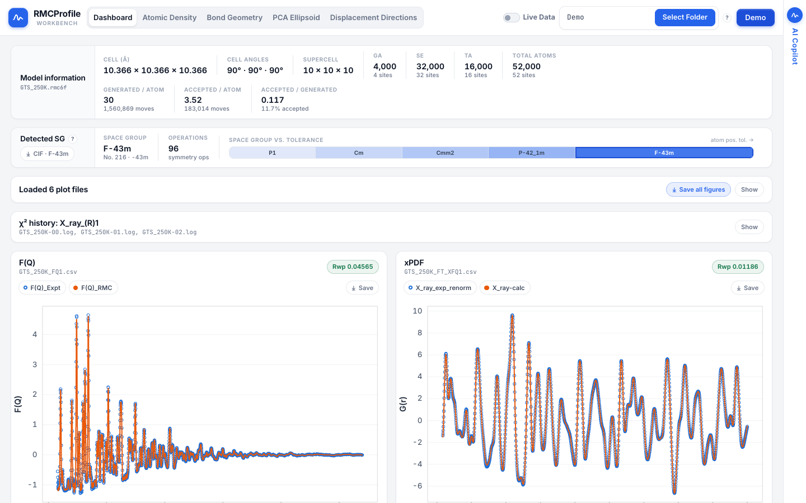
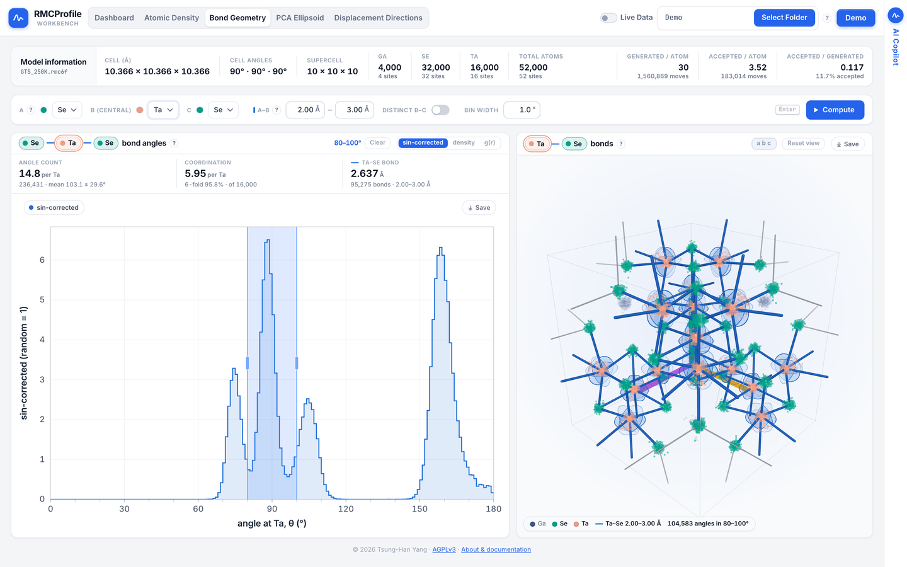
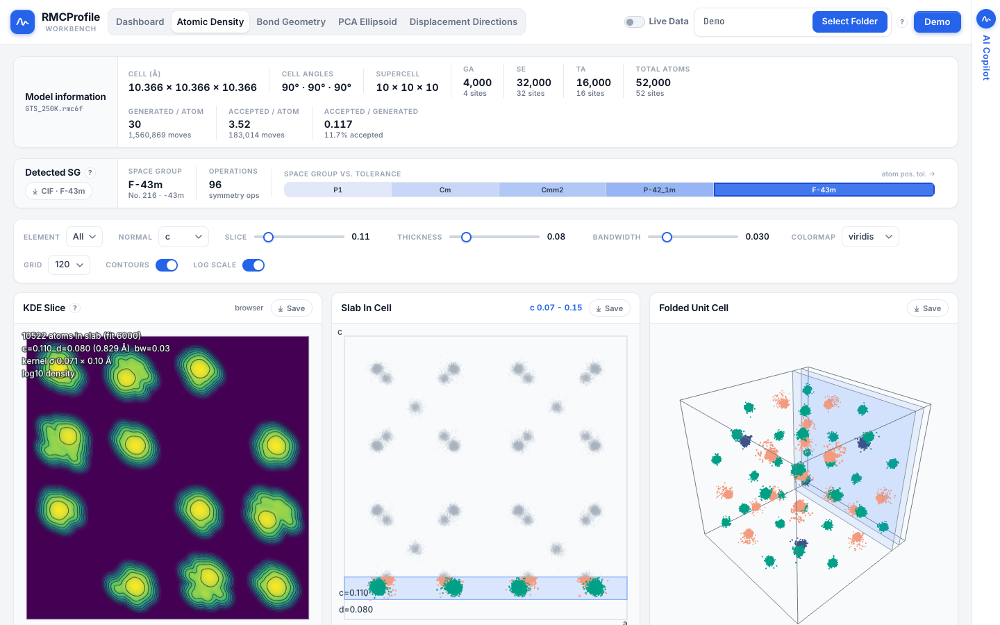
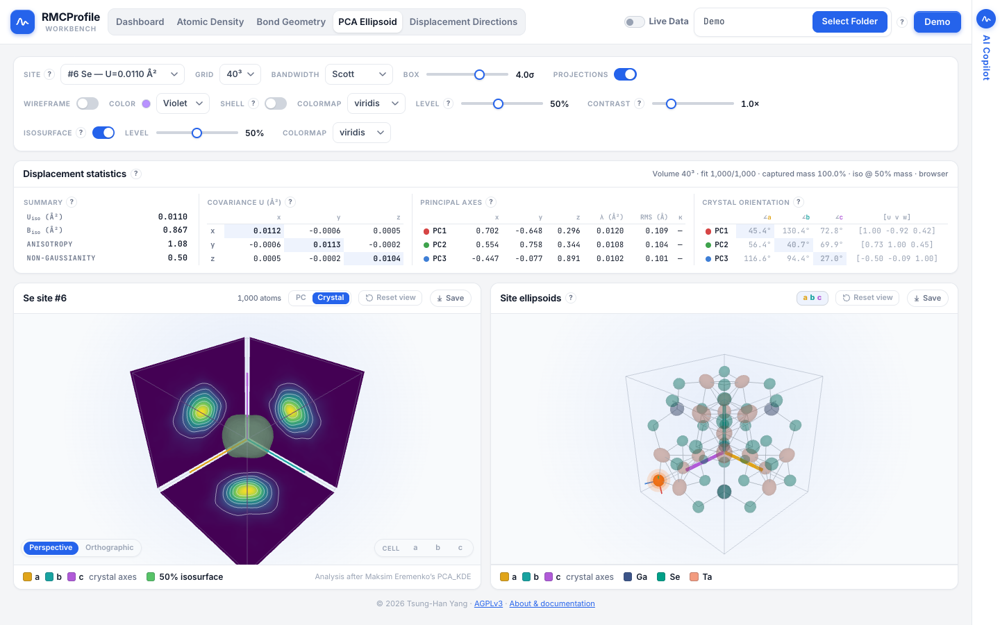
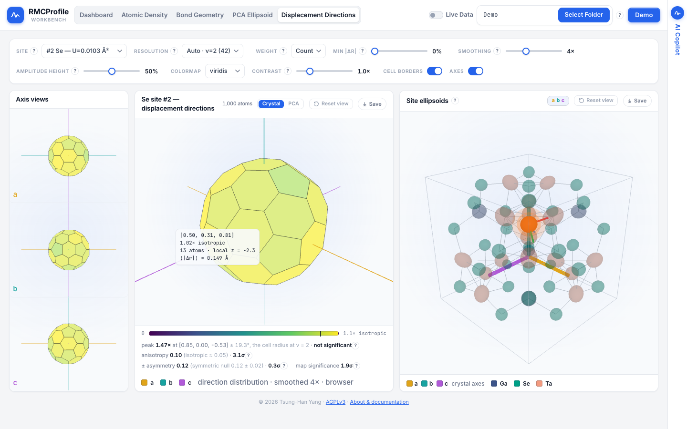
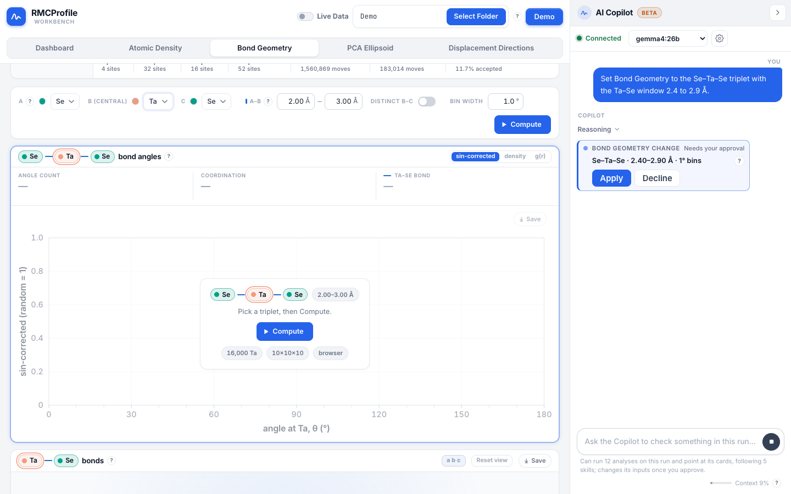
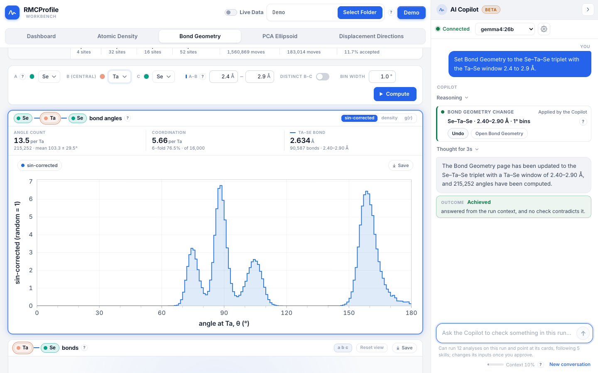

# RMCProfile Workbench

[](https://github.com/drthyang/rmc-toolkits/actions/workflows/tests.yml)
[](LICENSE)

An **interpretation workbench for RMCProfile runs.** Open a finished (or running) RMCProfile run
folder in the browser and use it to **judge the fit** (data against model, the χ² history, the
space group the configuration keeps), **read the local structure** (bond angles, thermal
ellipsoids, displacement directions, atomic density) and **decide the next step**: the next
analysis, or the next RMC run. An optional **AI Copilot** beside the pages runs those same analyses
for you and checks its own answers. Nothing to install.

### ▶️ Open the app: [drthyang.github.io/rmc-toolkits](https://drthyang.github.io/rmc-toolkits/)

1. Open the link above (desktop, iPad or phone).
2. Press **Demo** for the bundled example run (GaTa₄Se₈, 250 K), or **Select Folder** and pick
   your own RMCProfile run directory.
3. Move between **Dashboard**, **Atomic Density**, **Bond Geometry**, **PCA Ellipsoid** and
   **Displacement Directions**; open the **AI Copilot** rail at the right edge to ask questions.



<sub>The Dashboard on the Demo run.</sub>

🔒 **Your run files never leave your device.** They are read and rendered in your browser and are
never uploaded to rmc-toolkits or any project server. (Your browser's picker may say "Upload", but
nothing is sent.) A cloud AI model, if you choose one, receives summaries and analysis results
only.

## What it does

- **Dashboard:** the fits (G(r), F(Q)/S(Q), Bragg, partials, EXAFS) with their Rw, the χ² history,
  model information and the **Detected SG** ladder (the space group the configuration keeps as the
  tolerance tightens), with PNG/SVG/ZIP and CIF export.
- **Bond Geometry:** bond-angle distributions the RMCProfile `triplets` way (A–B–C, B central),
  with bond windows checked against the run's partial g(r). Drag an angle range to see those
  angles' bonds and wedges in the 3D cell.
- **PCA Ellipsoid:** per-site thermal ellipsoids from the displacement clouds, a 3D KDE isosurface
  and each principal axis in the crystal frame, after Maksim Eremenko's
  [PCA_KDE utilities](https://github.com/MaximEremenko/Utilities/tree/main/RMCProfileUtilities/PCA_KDE).
- **Displacement Directions:** where atoms move, binned in solid angle on a sphere, with a
  calibrated significance for each preferred direction.
- **Atomic Density:** KDE density slices (WebGPU with a CPU fallback), a draggable slab and a 3D
  folded unit cell.
- **Live Data:** the charts refresh while a run writes new files (Chromium browsers, or the local
  Flask backend).
- **Python package and CLIs:** the same engines as a library (`rmc_toolkits`), bond angles from the
  command line (`rmc-triplets`), automatic S(Q) scaling (`rmc-autoscale`) and an optional Flask
  backend.

## Screenshots

All from the bundled public Demo run.

<table>
  <tr>
    <th width="50%">Bond Geometry: an angle range and its bonds in 3D</th>
    <th width="50%">Atomic Density: KDE slice, slab, 3D cell</th>
  </tr>
  <tr>
    <td width="50%"></td>
    <td width="50%"></td>
  </tr>
  <tr>
    <th width="50%">PCA Ellipsoid: a Ta site's ellipsoid and its three projections</th>
    <th width="50%">Displacement Directions: a Ta site's direction sphere</th>
  </tr>
  <tr>
    <td width="50%"></td>
    <td width="50%"></td>
  </tr>
  <tr>
    <th width="50%">The Copilot asks before it changes an input</th>
    <th width="50%">Applied: the page computes, Undo on the card</th>
  </tr>
  <tr>
    <td width="50%"></td>
    <td width="50%"></td>
  </tr>
</table>

<sub>Screenshots © 2026 Tsung-Han Yang. The Copilot shots use gemma4:26b on a local Ollama.</sub>

## AI Copilot (beta)

Ask about the open run in plain language. The Copilot runs the Workbench's analyses (the site
table, g(r) peaks and coordination shells, bond angles, displacement directions, symmetry at a
tolerance, convergence, where the fit misses the data, clusters, polyhedra, modulations), shows
each as a step card with deterministic checks, points at the cards and peaks it explains, and asks
you when a choice would change the result. **Show in** opens the same analysis on its page.

It works with a **local** model (Ollama or LM Studio: nothing leaves your machine) or, with your
own key, a **cloud** one (OpenAI, Gemini, Anthropic). Setup, including connecting a local Ollama
to the hosted site: [QuickStart, *4. AI Copilot*](QuickStart.md#4-ai-copilot-optional).

### How the Copilot stays safe

- **Local models keep the data on the machine.** With Ollama or LM Studio nothing is sent anywhere;
  a cloud provider is labelled as such and warns before you use it.
- **Analyses only compute.** They read the run and return results; your files are never changed.
- **One change tool, and it asks first.** The only tool that changes anything sets the Bond
  Geometry inputs (triplet, bond windows, bin width). The change waits on a card until you press
  **Apply** (or **Decline**). *Changes: Ask first* is the default; *Auto* is opt-in and resets to
  Ask first on every reload. **Undo** on the card restores the earlier inputs, and if the page
  changed while the card waited, the change is refused instead of applied to a different state.
- **Numbers come from the tools, not the model.** The model quotes numbers by reference to a tool
  result, and the app fills them in from that result. A reference that names no value is sent back
  to the model to fix; a raw reference is never shown.
- **Answers are checked.** An evidence gate sends an answer back when it makes a claim without the
  analysis that claim needs. Answer checks compare the answer with what the analyses and the run
  established, and every answer ends with an **Outcome**: a contradiction adds a **Check** line and
  lowers it to **Not verified**, whatever the model said.
- **No silent truncation.** A **Context** meter shows how full the model's context window is; the
  Copilot refuses a question the loaded context cannot hold, and the chat says whenever earlier
  conversation stops being sent in full.

How it works, its tools and privacy in detail: the [Copilot guide](web_app/frontend/src/llm/README.md).

### Validation

Does the Copilot help? The protocol ([copilot-validation.md](docs/algorithms/copilot-validation.md),
protocol 2026-11-01.1) uses **14 synthetic cases with planted truth** (off-centring, modulations,
cluster distortions, Jahn–Teller, symmetry lowering, chirality and null cases), held out as a
sealed test split that no tool, skill or prompt was tuned on. Each case gets one open question (is
there order beyond the average structure, and what is the space group?), and the verdict is scored
by fixed rules written before any model run.

| Arm | Mean score |
| --- | --- |
| A: default pages, no model | 0.800 |
| B: Copilot, Claude Sonnet 5.5 | **0.920** |
| A+: every engine, no model | 0.948 |
| Planted truth | 1.000 |

Arm A reads the default Workbench pages by fixed rules. Arm A+ runs every engine exhaustively and
joins the results by fixed rules. Arm B is 3 runs per case, 42 runs.

With Claude Sonnet 5.5 the Copilot **beats the default pages** (0.920 against 0.800). It **does not
yet beat the exhaustive engine sweep** on this score (0.948). gemma4:26b scored 0.748 under an
earlier protocol (2026-10-24.6), which is not strictly comparable. Muse Glimmer ran only 3 of the
14 cases, so it is not reported as a result.

## Run it locally (optional)

The hosted app needs no install. To run the Flask backend and its SciPy/NumPy engines on your own
machine:

```bash
python3 -m venv .venv && source .venv/bin/activate
pip install -r web_app/backend/requirements.txt && pip install -e .
(cd web_app/frontend && npm install && npm run build)   # Node 20.19+ or 22.12+
python web_app/backend/app.py                           # http://127.0.0.1:5000/
```

Self-hosting, the backend API, file patterns and the Python package:
[docs/REFERENCE.md](docs/REFERENCE.md).

## Status

Beta: version **0.8.0** ([changelog](docs/CHANGELOG.md)). The Python package needs Python 3.10 or
newer. The AI Copilot is experimental: trust its step cards' checks over its own verdict.

## Documentation

- [QuickStart.md](QuickStart.md): the user guide, page by page, with Live Data and Copilot setup.
- [docs/demo-script.md](docs/demo-script.md): a 5–10 minute walkthrough of the Demo.
- [docs/REFERENCE.md](docs/REFERENCE.md): local and self-hosted setup, the backend API, file
  patterns, the Python package and command-line tools, tests.
- [docs/ALGORITHMS.md](docs/ALGORITHMS.md): the math of every page, anchored to the code, with the
  approximations stated.
- [AI Copilot guide](web_app/frontend/src/llm/README.md): how it works, its tools, privacy, setup.
- [docs/AGENT_PLAN.md](docs/AGENT_PLAN.md) and
  [copilot-validation.md](docs/algorithms/copilot-validation.md): the Copilot's architecture and
  how it is validated.
- [docs/demo-qa.md](docs/demo-qa.md): the end-to-end QA of the Demo for 0.8.0.
- [docs/ROADMAP.md](docs/ROADMAP.md) · [docs/CHANGELOG.md](docs/CHANGELOG.md) · [AGENTS.md](AGENTS.md)
  (contributor guide).

## License

[AGPL-3.0](LICENSE) © 2026 Tsung-Han Yang ([what that means, and citing](docs/REFERENCE.md#license-and-citation)).

*This project is personal work, developed and maintained in my personal capacity.*
