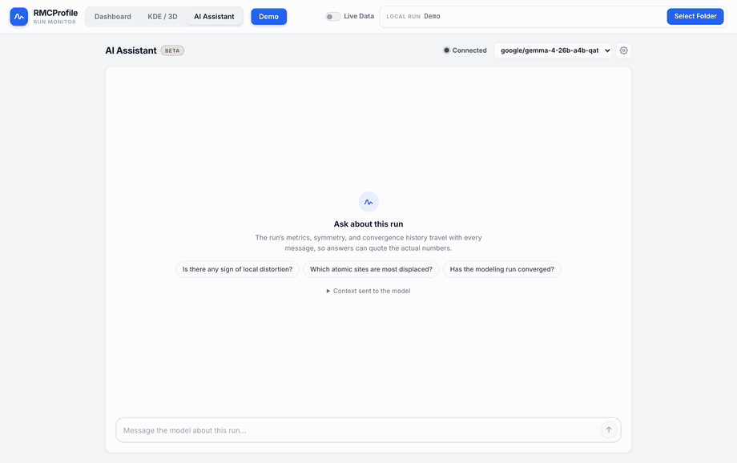

# RMCProfile Workbench

[](https://github.com/drthyang/rmc-toolkits/actions/workflows/tests.yml)
[](LICENSE)

A **browser-first dashboard** for inspecting **RMCProfile** modeling run folders. Open the hosted
app, select a run directory, and review plots, model information, atomic-density KDE slices, PCA
thermal ellipsoids, displacement-direction maps, bond-angle distributions, symmetry, and 3D
structure views without installing anything.

### ▶️ Open the app — [drthyang.github.io/rmc-toolkits](https://drthyang.github.io/rmc-toolkits/)

1. Visit the link above.
2. Click **Select Folder** and choose your RMCProfile run directory — or press **Demo** for a
   bundled example run.
3. Everything renders in your browser.

🔒 **Your raw run files never leave your device.** They are read and rendered entirely in your
browser and are never uploaded to rmc-toolkits or any project server. (Your browser's picker may
say “Upload”, but nothing is sent anywhere.)[^cloud-llm-privacy]

⚡ **Live monitoring** auto-refreshes charts as new files are written, in Chromium browsers (Chrome,
Edge, Arc, Opera).

🤖 **AI Copilot (beta)** — a panel docked beside the pages that answers questions about the open run by
running the Workbench analyses itself: 10 tools (convergence, g(r) shells and coordination, where the
fit misses the data, site displacements, displacement directions, bond angles, cluster distortion
against independent atoms, a superstructure test, symmetry at any tolerance, the run summary). Each result
carries deterministic checks, and each answer ends with an **Outcome** verdict. It explains by
pointing: the cards it talks about breathe a blue edge, it marks the peaks it names on a plot, its
answers cite cards as clickable chips, and it turns the 3D views to look down the direction it
describes. It works with any
OpenAI-compatible model: local (Ollama, LM Studio; nothing leaves your machine) or cloud (OpenAI,
Gemini, Anthropic, with your key). Tested on the Demo with gemma4:26b and qwen3.8-27b
([results](#ai-copilot)).

📖 **New here?** Start with [QuickStart.md](QuickStart.md). Everything else — local/self-hosted
setup, backend API, file formats — lives in [docs/REFERENCE.md](docs/REFERENCE.md).

## Features

- **Run dashboard** — auto-detects RMCProfile outputs (PDF/G(r), S(Q), Bragg profiles, partials,
  EXAFS Q/R CSVs, χ² logs) and renders interactive charts with hover readouts, drag-to-zoom,
  and PNG/SVG/`.zip` export.
- **Live Data** — charts auto-refresh while your run writes new files: client-side in Chromium
  browsers, or server-side through the optional Flask backend, where the analysis pages also reload
  in place when the run saves a new configuration.
- **Atomic Density** — KDE density slices (WebGPU with automatic CPU fallback), a draggable
  slab-in-cell projection, and a Three.js folded unit-cell view of `.rmc6f` structures.
- **PCA Ellipsoid** — per-site thermal ellipsoids from the RMC displacement clouds: anisotropic
  displacement tensor, 3D KDE isosurface with wall projections, non-Gaussianity readouts, and each
  principal axis's angles to a/b/c with the crystallographic direction [u v w] it runs along.
  Follows Maksim Eremenko's
  [PCA_KDE utilities](https://github.com/MaximEremenko/Utilities/tree/main/RMCProfileUtilities/PCA_KDE)
  (independent reimplementation).
- **Displacement Directions** — the direction-space counterpart to the ellipsoid: displacement
  directions binned in solid angle on a hex-tiled sphere reveal discrete hop directions and ±u
  asymmetry that the U tensor cannot see, each with a calibrated significance test.
- **Bond Geometry** — bond-angle distributions the RMCProfile `triplets` way: name an A–B–C
  triplet with **B central**, bracket the bond lengths against the run's partial g(r), and get the
  angle histogram over the periodic configuration with coordination statistics. The folded unit
  cell shows the detected bonds over the measured atom cloud.
- **Symmetry analysis** — a client-side, FINDSYM-like panel reports the detected space group and
  how it changes with tolerance. Screw axes and glide planes are read from each operation's
  translation part, so non-symmorphic groups are named as themselves (Pnma, I4/mcm, Fd-3m),
  resolved against all 230 groups with Wyckoff letters per orbit. The group is named in its
  standard setting, which the finder searches for from the detected symmetry elements (another axis
  order, a centred or primitive cell, or the true cell of a supercell); when it cannot be named
  reliably the panel shows the crystal class or a lower bound, never a guessed number. Unlike
  FINDSYM it does no origin shift and outputs no idealized structure. The panel needs the run
  parsed in the browser (the hosted/static dashboard, or a locally picked folder); a run read
  through the local Flask server has no site basis, so the panel does not appear there.
- **AI Copilot (beta)** — a panel docked beside every page (a bottom sheet on portrait tablets and phones),
  resizable, collapsing to a slim rail. Ask about the loaded run, and a
  local LLM (Ollama, LM Studio) or an opt-in cloud model (OpenAI, Gemini, Anthropic) runs the
  Workbench analyses itself. It can list
  the site displacements, test displacement directions, compute bond angles, measure the distortion
  of clusters (M₄ tetrahedra, dimers, trimers) against independent atoms, test for order that
  doubles the cell, integrate coordination numbers, locate the misfit in r or Q, re-run the symmetry finder and check convergence. The run
  summary it reads says which partials each dataset barely sees and where the symmetry ladder is
  sampling noise. It reads each result with deterministic checks, retries when one
  fails, and ends with an **Outcome** verdict. While it explains, it points at the page: the cards
  it talks about breathe a blue edge (their page opens and they scroll into view), the g(r) peaks
  it names are marked, its answers cite cards as chips you can click, and it turns a 3D view to
  look down a direction such as [111], or rings and selects the sites it names. A step's *Show in*
  button loads the same analysis on its page, beside the chat. The analyses only compute; the
  view tools change only what is on screen. Only compact summaries are sent, never raw files.[^cloud-llm-privacy] Setup:
  [`web_app/frontend/src/llm/README.md`](web_app/frontend/src/llm/README.md).
- **Python package (`rmc_toolkits/`)** — the same parsing, plotting, KDE, PCA-ellipsoid, and
  displacement-direction analyses as a reusable library, plus `.rmc6f` conversion helpers.

[^cloud-llm-privacy]: If you opt into a cloud LLM, the compact summarized run context, and the
    summaries of the analyses the Copilot runs, are sent directly to the cloud LLM server you
    selected. A settings switch turns the analyses off. Raw run files are not uploaded to
    rmc-toolkits.

## Screenshots

| Run dashboard | Atomic density (KDE / slab / 3D) |
| --- | --- |
|  |  |

| PCA ellipsoid (thermal ellipsoids) | Displacement directions |
| --- | --- |
|  |  |

### AI Copilot

Ask about the loaded run in plain language. The run's metrics, symmetry and convergence history
travel with every question. When those are not enough, the Copilot runs the analysis itself and
shows each one as a step card: what it ran, how long it took, and the verdict of its checks.
Expand a card to see the exact numbers the model read. Press *Show in* to load the same analysis
on its page (Bond Geometry computes the same triplet; Displacement Directions opens the same site)
while the Copilot stays open beside it.

**It points at what it explains.** The Copilot is docked beside the pages, never over them: on a
laptop, a monitor or a tablet in landscape it is a side panel the pages reflow around (drag its
edge to resize; the pages keep at least 760 px), on portrait tablets and phones a bottom sheet,
and collapsed a slim rail with a dot when a new answer arrived. It remembers its width and whether
it was open. While it explains, the
card it is talking about breathes a blue edge, and its page opens and scrolls to it; on a plot it
marks the positions it names (the first g(r) peaks, say) and zooms to them. Its answers cite cards
as chips: click one to bring the card back. In 3D it looks down the direction it describes —
"looking down [111] on the displacement sphere…" — and can centre, ring in blue, or select the
sites it names. A click anywhere on the page, or the next question, ends the highlight.
The answer ends with an **Outcome** chip (achieved, partial or not achieved) and quotes the
numbers. Reasoning models stream their chain of thought in a collapsible *Thinking* panel.

**Turn it on.** Run a local server with a tool-capable model (Ollama, or LM Studio with CORS
enabled), or have a cloud API key ready. Click the **AI Copilot** rail at the right edge (a bar at
the bottom on portrait tablets and phones), open the
settings (gear), pick the provider, press **Test** and choose the model. *Let the Copilot run
analyses* is on by default; off, it answers from the run summary only. Setup details:
[`web_app/frontend/src/llm/README.md`](web_app/frontend/src/llm/README.md#provider-setup).

**Tested with real models** (2026-10-10, the Demo run, six questions, a new conversation each):

| Model | Tools called | Right answers | Time per question |
| --- | --- | --- | --- |
| gemma4:26b (Ollama) | 1–2 per question; none when the run summary already held the answer | 5 of 6 fully. Bond angles: before the fixes below it read a too-narrow window as "incomplete octahedra"; after them it used the whole shell but missed the trans angles near 160° | 8–95 s |
| qwen3.8-27b (LM Studio) | 1–3 per question; widened a too-narrow bond window by itself | 4 of 6 fully; the symmetry answer had the groups right but two wrong claims; the bond-angle answer did not finish within 15 min | 1–5 min, over 15 min once |

No tool call was malformed. The verdict is the model's self-assessment: both models always wrote
*achieved*, so read the step cards' checks. The runs found four bugs, now fixed (a verdict line in
backticks, two bond-window checks, and a crash on a mid-stream server error);
[details](web_app/frontend/src/llm/README.md#tested-with-real-models). qwen3:32b was not run.

Below,
recorded with the earlier chat-only version, a local model (Ollama) summarizes the bundled demo
run as a table, with LaTeX math such as Rwp and χ² rendered inline.



## The Math Under the Hood

Nothing here is a black box. [docs/ALGORITHMS.md](docs/ALGORITHMS.md) is a code-anchored account of
**every operation each page performs on your data** — each step naming the file and function that
runs it, with the approximations stated rather than buried. The signature equations, one per
analysis page:

**Fit residual** — the chip on each dashboard chart:

$$R=\sqrt{\frac{\sum_i\bigl(y^{\mathrm{calc}}_i-y^{\mathrm{expt}}_i\bigr)^2}{\sum_i\bigl(y^{\mathrm{expt}}_i\bigr)^2}}$$

normalized by the experiment. RMCProfile writes these CSVs as `(x, calculated, experimental)`; a
header that names the roles overrides that order. Labelled "Rwp" but **unweighted**, so it is not
the crystallographic $R_\mathrm{wp}$; recompute from the columns before quoting it in a paper.
Points where either column is non-finite are skipped, and if none remain — or the denominator is
zero — the chip reads **—**.
→ [derivation](docs/algorithms/run-dashboard.md#step-5--compute-the-numbers)

**Atomic density** — a 2-D Gaussian KDE over the supercell folded into one unit cell, with
bandwidth $\mathbf H$ scaled from the covariance $\mathbf C$ of the slab's atoms (SciPy's
convention; the same kernel in the browser and in Python):

$$\rho(\mathbf p)=\frac{\kappa}{n}\sum_{i=1}^{n}\frac{\exp\!\left[-\tfrac12(\mathbf p-\mathbf p_i)^{\!\top}\mathbf H^{-1}(\mathbf p-\mathbf p_i)\right]}{2\pi\sqrt{\det\mathbf H}},\qquad \mathbf H=f^2\mathbf C$$

$\kappa$ corrects for the neighbour images tiled around the cell to restore periodicity.
→ [derivation](docs/algorithms/structure.md#step-6--the-gaussian-kernel-bandwidth-matrix-and-normalization)

**Thermal ellipsoids** — the anisotropic displacement tensor is the displacement covariance, and the
drawn surface is its $\chi^2$ probability ellipsoid:

$$U_{ab}=\frac{1}{n-1}\sum_n u_{na}u_{nb},\qquad\text{semi-axes } k(p)\,\sigma_a,\quad k(p)=\sqrt{F^{-1}_{\chi^2_3}(p)}$$

The crystallographic 50 % convention is $k=1.5382$. $U$ is Cartesian — there is no conversion to
$U_\mathrm{cif}$ or $\beta_{ij}$ anywhere.
→ [derivation](docs/algorithms/pca-ellipsoid.md#step-3--covariance-and-eigen-decomposition)

**Displacement directions** — amplitude discarded, directions binned in solid angle on a Goldberg
sphere of $10\nu^2+2$ cells, each count divided by that cell's *exact* solid angle $\Omega_m$:

$$\mathbf u_i=\frac{\Delta\mathbf r_i}{\lVert\Delta\mathbf r_i\rVert},\qquad \rho_m=\frac{M_m}{\bigl(\sum_{m'}M_{m'}\bigr)\Omega_m},\qquad \mathcal E_m=4\pi\rho_m$$

The plotted enhancement $\mathcal E$ is dimensionless: 1 is isotropic, and 1.8 means "this direction
is 1.8× more likely than chance".
→ [derivation](docs/algorithms/displacement-directions.md#step-6--the-histogram)

**Bond angles** — the angle at the central atom B of every A–B–C triplet whose two bonds fall
inside their windows, divided by the *exact* isotropic fraction of each bin:

$$\theta=\arccos\frac{\mathbf r_{BA}\cdot\mathbf r_{BC}}{\lVert\mathbf r_{BA}\rVert\lVert\mathbf r_{BC}\rVert},\qquad S_k=\frac{N_k/N}{\bigl(\cos\theta_k-\cos\theta_{k+1}\bigr)/2}$$

Because $(\cos\theta_k-\cos\theta_{k+1})/2=\sin\theta_c\,\sin(\Delta/2)$, this is the bin-centre
$1/\sin\theta_c$ correction scaled so that $S=1$ is randomly oriented bonds; a peak above 1 is real
structure. RMCProfile's `triplets` `norm/sin(theta)` column has the same shape on another scale
($=S\cdot\sin(\Delta/2)/\Delta_{\deg}\approx S\cdot\pi/360$). Neighbours are found by a linked-cell
search carrying explicit periodic-image shifts — exact for triclinic cells and for boxes smaller
than the cutoff.
→ [derivation](docs/algorithms/bond-geometry.md#step-6--the-histogram-and-its-three-normalizations)

The Python package is the reference implementation; the browser workers are hand-written ports of
it. Which port is parity-tested against Python goldens — and which is only pinned to its own
in-language reference — is stated per engine, along with the measured tolerances.

## Run It Locally (optional)

The hosted app needs no install. Run the Flask backend when you want server-side file browsing or
the reference-grade SciPy/NumPy engines on your own machine:

```bash
python3 -m venv .venv && source .venv/bin/activate
pip install -r web_app/backend/requirements.txt && pip install -e .
(cd web_app/frontend && npm install && npm run build)   # Node 20.19+ or 22.12+
python web_app/backend/app.py                           # http://127.0.0.1:5000/
```

This development server listens on `127.0.0.1` only, with debug mode off. To self-host on a
network, use Gunicorn or the Docker image, and never enable `RMC_TOOLKITS_DEBUG` on a server
others can reach (its interactive debugger runs arbitrary code). Ports, bind address, data roots,
dev servers, Docker/GitHub Pages deployment, the backend API, and supported file patterns are
covered in [docs/REFERENCE.md](docs/REFERENCE.md).

## Python Package

```python
from rmc_toolkits import load_unit_cell_positions, make_plot, oriented_kde_slice, plot_to_png

demo = "web_app/frontend/public/demo"  # bundled GaTa4Se8 250 K example run

# The Atomic Density map of Se in a c-slab at 0.12 of the cell edge, 0.08 thick, bw 0.03:
# the same numbers GET /api/kde/slice returns for these parameters.
positions = load_unit_cell_positions(f"{demo}/GTS_250K.rmc6f", element="Se")
density = oriented_kde_slice(
    positions.fractional_positions, center=0.12, thickness=0.08, normal=(0, 0, 1), bw=0.03
)
png_bytes = plot_to_png(make_plot(f"{demo}/GTS_250K_FQ1.csv"))
```

Full usage, parser helpers, the `rmc-autoscale` and `rmc-triplets` command-line tools, and the
legacy CLI scripts: [docs/REFERENCE.md](docs/REFERENCE.md#python-package-usage).

## Documentation

- [QuickStart.md](QuickStart.md) — guided tour of the hosted app, including AI-assistant setup.
- [docs/ALGORITHMS.md](docs/ALGORITHMS.md) — **the math**: a code-anchored account of every
  operation each page performs on your data, so you can audit how a plot, density map, symmetry
  label, scaled dataset, or direction map was produced — including the approximations.
- [docs/REFERENCE.md](docs/REFERENCE.md) — repository layout, setup, self-hosting, backend API,
  supported file patterns, package usage, command-line tools, legacy CLI scripts, tests.
- [docs/ROADMAP.md](docs/ROADMAP.md) · [docs/CHANGELOG.md](docs/CHANGELOG.md) — plans and history.
- [AGENTS.md](AGENTS.md) — architecture notes and contributor onboarding.

## License

Released under the [GNU Affero General Public License v3.0](LICENSE) © 2026 Tsung-Han Yang.

The AGPL is a strong copyleft license: you may use, study, modify, and redistribute this
software, but derivative works must also be released under the AGPLv3. Notably, if you run a
modified version as a **network service**, you must offer its complete source code to the users
of that service (AGPL §13). If you use rmc-toolkits in published research, please cite it.

*This project is personal work, developed and maintained in my personal capacity.*
