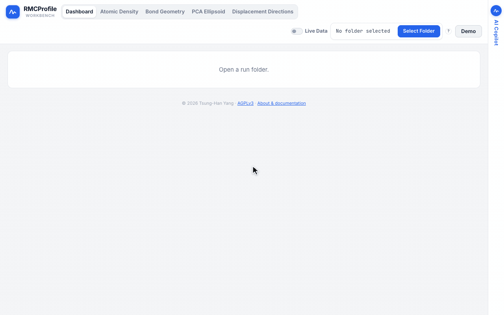
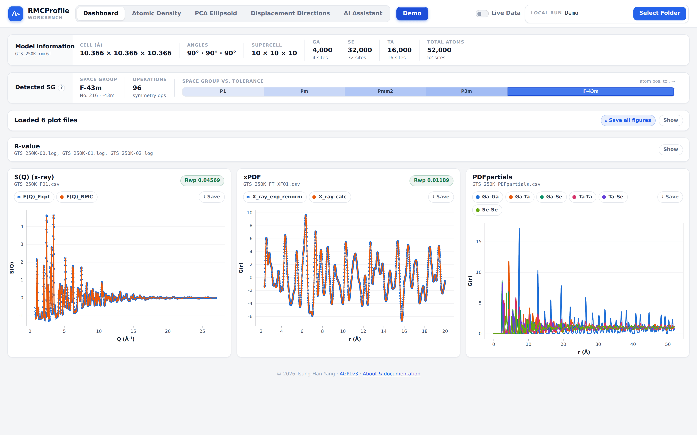
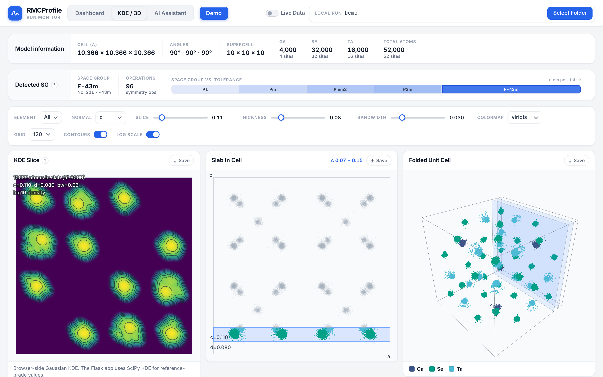
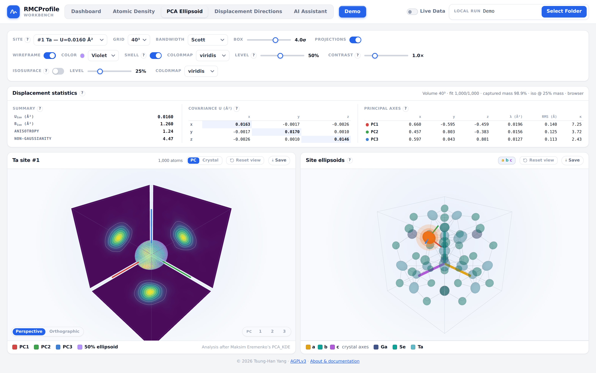
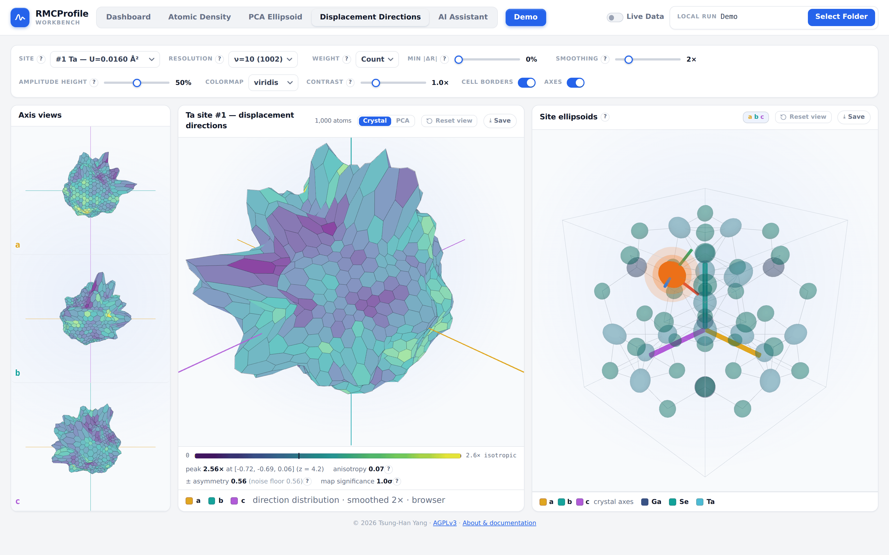

# RMCProfile Workbench

[](https://github.com/drthyang/rmc-toolkits/actions/workflows/tests.yml)
[](LICENSE)

A **browser-first workbench** for inspecting **RMCProfile** modeling runs. Open the hosted app,
select a run folder, and review the fits, the χ² history, atomic-density maps, thermal ellipsoids,
displacement directions, bond angles, symmetry and 3D structure views, with nothing to install.
An **AI Copilot** beside the pages answers questions about the run by running those analyses
itself.

### ▶️ Open the app: [drthyang.github.io/rmc-toolkits](https://drthyang.github.io/rmc-toolkits/)

1. Visit the link above.
2. Click **Select Folder** and choose your RMCProfile run directory, or press **Demo** for a
   bundled example run (GaTa₄Se₈, 250 K).
3. Everything renders in your browser.



<sub>The AI Copilot on the Demo run with a local model (Muse Glimmer on LM Studio), sped up while
the model thinks. It reads its coordination-shells skill, finds the whole Ga–Se shell in the
partial g(r), computes the Se–Ga–Se angles in that shell, flags the 2.2 Å closest-approach cut,
and shows the same analysis on the Bond Geometry page.</sub>

🔒 **Your run files never leave your device.** They are read and rendered in your browser and are
never uploaded to rmc-toolkits or any project server. (Your browser's picker may say "Upload", but
nothing is sent.) A cloud AI model, if you choose one, receives summaries only.

⚡ **Live Data** refreshes the charts while a run writes new files, in Chromium browsers (Chrome,
Edge, Arc, Opera) or through the local Flask backend.

🤖 **AI Copilot (beta).** Ask about the open run in plain language. The Copilot runs the
Workbench's analyses, shows each one as a step card with deterministic checks, points at the cards
and plot peaks it explains, and asks you when a choice would change the result. It works with a
local model (Ollama, LM Studio; nothing leaves your machine) or, with your key, a cloud one
(OpenAI, Gemini, Anthropic).

📖 **New here?** Start with [QuickStart.md](QuickStart.md).

## Features

- **Run dashboard:** interactive charts of the fits (G(r), F(Q)/S(Q), Bragg, partials, EXAFS) and
  the χ² history, with hover readouts, drag-to-zoom, model information, the detected space group
  and PNG/SVG/ZIP export.
- **Atomic Density:** KDE density slices (WebGPU with a CPU fallback), a draggable slab-in-cell
  projection and a 3D folded unit cell of the `.rmc6f` structure.
- **Bond Geometry:** bond-angle distributions the RMCProfile `triplets` way (an A–B–C triplet with
  B central), with bond windows bracketed against the run's partial g(r).
- **PCA Ellipsoid:** per-site thermal ellipsoids from the displacement clouds, with a 3D KDE
  isosurface and each principal axis in the crystallographic frame, after Maksim Eremenko's
  [PCA_KDE utilities](https://github.com/MaximEremenko/Utilities/tree/main/RMCProfileUtilities/PCA_KDE).
- **Displacement Directions:** where atoms move, binned in solid angle on a sphere, with a
  calibrated significance test for each preferred direction.
- **Symmetry:** the space group and how it changes with tolerance, named correctly for
  non-symmorphic groups, with Wyckoff letters for all 230.
- **Python package and CLIs:** the same engines as a library (`rmc_toolkits`), bond angles from the
  command line (`rmc-triplets`), automatic S(Q) scaling (`rmc-autoscale`) and an optional Flask
  backend.

## Screenshots

| Run dashboard | Atomic density (KDE / slab / 3D) |
| --- | --- |
|  |  |

| PCA ellipsoid (thermal ellipsoids) | Displacement directions |
| --- | --- |
|  |  |

## AI Copilot

Turn it on from the **AI Copilot** rail at the right edge: open its settings (gear), pick a
provider, press **Test** and choose a model. The run's metrics, symmetry and convergence history
travel with every question; when they are not enough, the Copilot runs an analysis and shows it as
a step card you can expand to see the exact numbers the model read. **Show in** loads the same
analysis on its page, beside the chat. Every answer ends with an **Outcome** chip, and an answer
the checks contradict is marked **Not verified**. How it works, its tools, privacy and provider
setup: the [Copilot guide](web_app/frontend/src/llm/README.md).

## Run it locally (optional)

The hosted app needs no install. To run the Flask backend and its SciPy/NumPy engines on your own
machine:

```bash
python3 -m venv .venv && source .venv/bin/activate
pip install -r web_app/backend/requirements.txt && pip install -e .
(cd web_app/frontend && npm install && npm run build)   # Node 20.19+ or 22.12+
python web_app/backend/app.py                           # http://127.0.0.1:5000/
```

Self-hosting, the backend API, file patterns and the Python package:
[docs/REFERENCE.md](docs/REFERENCE.md).

## Status

Beta: version 0.7.0, with unreleased changes on main ([changelog](docs/CHANGELOG.md)). The AI
Copilot is experimental: trust its step cards' checks over its own verdict.

## Documentation

- [QuickStart.md](QuickStart.md): a tour of the app, Live Data and Copilot setup.
- [docs/REFERENCE.md](docs/REFERENCE.md): local and self-hosted setup, the backend API, file
  patterns, the Python package and command-line tools, tests.
- [docs/ALGORITHMS.md](docs/ALGORITHMS.md): the math of every page, anchored to the code, with the
  approximations stated.
- [AI Copilot guide](web_app/frontend/src/llm/README.md): how it works, its tools, privacy, setup.
- [docs/ROADMAP.md](docs/ROADMAP.md) · [docs/CHANGELOG.md](docs/CHANGELOG.md) · [AGENTS.md](AGENTS.md)
  (contributor guide).

## License

[AGPL-3.0](LICENSE) © 2026 Tsung-Han Yang ([what that means, and citing](docs/REFERENCE.md#license-and-citation)).

*This project is personal work, developed and maintained in my personal capacity.*
