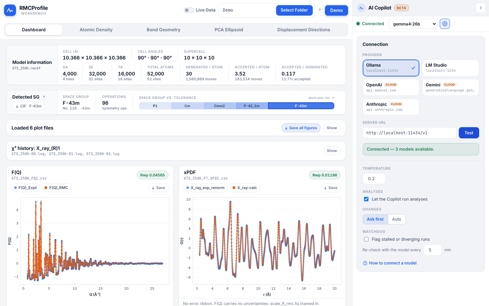

# Setting up the AI Copilot

The AI Copilot answers questions about the open run with a language model (an LLM). The Workbench
does not include a model: you connect one. This page shows how, step by step.

The Copilot is optional. Every page of the Workbench works without it.

- [1. What you need](#1-what-you-need)
- [2. Hosted model (API key)](#2-hosted-model-api-key)
- [3. Local model (Ollama or LM Studio)](#3-local-model-ollama-or-lm-studio)
- [4. Local proxy](#4-local-proxy)
- [5. Check it works](#5-check-it-works)
- [6. Troubleshooting](#6-troubleshooting)
- [How this page was checked](#how-this-page-was-checked)

## 1. What you need

1. **The Workbench in a browser.** Either the hosted site,
   <https://drthyang.github.io/rmc-toolkits/>, or a copy running on your own computer
   ([QuickStart](../QuickStart.md)). Use Chrome or Edge if you can; see the browser table in
   [section 3](#3-local-model-ollama-or-lm-studio) for Safari and Firefox.
2. **One model.** Choose one:

   | | Hosted model | Local model |
   |---|---|---|
   | What it is | A model run by OpenAI, Google (Gemini) or Anthropic | A model that runs on your own computer, in Ollama or LM Studio |
   | What you need | An API key from that provider (paid by use) | A computer with enough memory for the model (the models used for the checks on this page take 6 to 17 GB) |
   | Where your data goes | The run summary and the analysis results are sent to the provider | Nothing leaves your computer |
   | Setup | [Section 2](#2-hosted-model-api-key) | [Section 3](#3-local-model-ollama-or-lm-studio) |

All settings are in one place:

1. Click the **AI Copilot** rail at the right edge of the page (on a phone or a portrait tablet it
   is a bar at the bottom).
2. Click the gear (**Connection settings**) at the top of the panel. The **Connection** drawer
   opens.

The drawer has five **Provider** buttons (**Ollama**, **LM Studio**, **OpenAI**, **Gemini**,
**Anthropic**; the last three are marked *Cloud*), the **Server URL** box with the **Test** button,
and, for a cloud provider, the **API key** box. The model list (**Select a model…**) is at the top
of the panel, left of the gear.

Settings are saved as you type. There is no Save button.



<sub>Screenshot © 2026 Tsung-Han Yang. The bundled Demo run with the Connection drawer open.</sub>

## 2. Hosted model (API key)

With a hosted model, the run summary and the results of the analyses the Copilot runs are sent to
the provider. The drawer says so in a warning note (*Run data leaves your device*). Do not use a
hosted model for data you may not share.

1. Get an API key from the provider. A key is a long password for the provider's service; the
   provider bills its use to your account.
   - OpenAI: <https://platform.openai.com/api-keys>
   - Gemini: <https://aistudio.google.com/apikey>
   - Anthropic: <https://console.anthropic.com/settings/keys>

   (After you pick the provider, the drawer shows the same link as **Get a key ↗**.)
2. Open the **Connection** drawer (section 1).
3. Under **Provider**, click **OpenAI**, **Gemini** or **Anthropic**. The **Server URL** fills in by
   itself; leave it.
4. Paste the key into **API key** (for example `sk-...`).
5. Click **Test**. The drawer shows **Connected — N models available.**
6. Close the drawer (click the gear again) and choose a model from **Select a model…**. Choose one
   that can call tools (the provider's current general models can), or the Copilot answers from the
   run summary only.

Then go to [Check it works](#5-check-it-works).

### Where the key is stored

- The key is stored in this browser only, in the site's local storage (the entry
  `rmc-llm-settings-v1`), as plain text. It is not uploaded to the Workbench: the hosted site is a
  set of static files and has no server that could receive it.
- The key leaves the browser only inside requests to the address in **Server URL**. With a
  provider button chosen, that is the provider itself. If you type another address into **Server
  URL**, the key goes to that address, so clear **API key** first.
- While a cloud provider is selected, the Workbench asks it for its model list each time the page
  opens. That request carries the key and costs nothing.
- Anyone who can use your browser profile can read the key. On a shared computer, delete it when
  you finish: clear the **API key** box.
- A key is tied to one site address. A key saved on the hosted site is not visible to a local copy
  of the Workbench, and the other way round.

## 3. Local model (Ollama or LM Studio)

With a local model nothing leaves your computer: the browser talks straight to a model server on
the same machine.

The model server must *allow the web page* to call it. That is the one step that differs between
the hosted site and a local copy of the Workbench:

| Workbench | Ollama | LM Studio |
|---|---|---|
| Local copy (`http://localhost:…`) | Works with no extra step | Turn on CORS |
| Hosted site (`https://drthyang.github.io`) | Allow the site (step 3 below) | Turn on CORS |

(*CORS* is the browser rule behind this: a web page may read answers from another server only if
that server says the page is allowed.)

### Ollama

1. Install Ollama from <https://ollama.com> and start it.
2. Download a model that can call tools. In a terminal:

   ```bash
   ollama pull qwen3
   ```

   Check that the server answers:

   ```bash
   curl http://localhost:11434/v1/models
   ```

3. **Hosted site only:** allow the site, then restart Ollama.

   On macOS with the Ollama menu-bar app:

   ```bash
   launchctl setenv OLLAMA_ORIGINS "https://drthyang.github.io"
   ```

   Then quit Ollama from its menu-bar icon and open it again. The setting is lost when you log
   out; run the command again after the next login.

   If you start Ollama from a terminal instead (macOS or Linux; quit the menu-bar app first):

   ```bash
   OLLAMA_ORIGINS="https://drthyang.github.io" ollama serve
   ```

   Check it. This must print `200`; before the step it prints `403`:

   ```bash
   curl -s -o /dev/null -w "%{http_code}\n" -H "Origin: https://drthyang.github.io" http://localhost:11434/v1/models
   ```

4. In the Workbench, open the **Connection** drawer, click **Ollama** under **Provider**, then
   **Test**. The drawer shows **Connected — N models available.**
5. Choose the model from **Select a model…**.

You do not need to set a context length in Ollama. The Copilot asks for the size it needs with
each question.

### LM Studio

1. Install LM Studio from <https://lmstudio.ai> and download a model that can call tools.
2. Start its server with CORS on. In a terminal:

   ```bash
   lms server start --cors
   ```

   Or in the LM Studio window: **Developer** tab → server settings → **Enable CORS**, then start
   the server.

   Check it. The answer must contain the line `Access-Control-Allow-Origin: *`:

   ```bash
   curl -s -D - -o /dev/null -H "Origin: https://drthyang.github.io" http://localhost:1234/v1/models
   ```

3. Load the model with a context length of 32,768 tokens or more. In a terminal (`lms ls` lists
   the names of your models):

   ```bash
   lms load <model name> --context-length 32768
   ```

   Or choose the context length in the LM Studio window when you load the model. LM Studio fixes
   it at that moment. With 16,384 the Copilot refuses even the first question on the Demo: it says
   *this request needs about 20,594* and asks for *a context length of at least 32,768*. A refused
   question is not sent to the model.
4. In the Workbench, open the **Connection** drawer, click **LM Studio** under **Provider**, then
   **Test**. The drawer shows **Connected — N models available.**
5. Choose the model from **Select a model…**.

With CORS on, LM Studio answers *any* web page you visit, not only the Workbench. Stop the server
when you do not use it (`lms server stop`).

### Browsers

| Browser | Local copy of the Workbench | Hosted site with a local model |
|---|---|---|
| Chrome, Edge | Works | Works, after you let the site reach your local network. The browser asks the first time the Copilot connects: click **Allow**. If you blocked it, the connection fails as if the server were off |
| Safari | Works | Does not work: Safari stops an `https` page from calling `http://localhost`. Use Chrome or Edge, a hosted model, or a local copy of the Workbench |
| Firefox | Not tested | Not tested |

### Running a local copy of the Workbench

A local copy is the simplest way to use Ollama: no origin setting, no browser prompt. It needs
[Node.js](https://nodejs.org) and a copy of this repository.

```bash
cd web_app/frontend
npm ci
VITE_STATIC_MODE=true npm run build
npm run preview
```

Open <http://localhost:4173/>.

## 4. Local proxy

**The Workbench has no local proxy, and it does not need one for the setups above.** The browser
talks directly to the model server (or to the cloud provider). There is nothing to install or
start beside the model server itself.

A proxy is a small program on your computer that stands between the page and the model server and
passes the requests on. You only need one when the model server cannot be told to allow the page:

- a model server that has no setting like `OLLAMA_ORIGINS` or **Enable CORS**;
- an Ollama you may not restart or reconfigure;
- a model server on another computer of your lab network, reached over plain `http`. The hosted
  site is an `https` page, and browsers do not let an `https` page call an `http` address other
  than `localhost`.

Try the server's own setting first (section 3). It is simpler and has fewer parts.

### A small proxy you can run

The script below is **not part of the Workbench**. It is a minimal example for
[Node.js](https://nodejs.org) (no packages to install) that forwards the page's requests to one
model server and adds the answer headers the browser asks for. It listens on your own computer
only and serves one site only.

1. Save this as `copilot-proxy.mjs`:

   ```js
   // copilot-proxy.mjs: lets one web page reach one model server through this machine.
   import http from 'node:http';

   const TARGET = new URL(process.env.TARGET || 'http://localhost:11434');
   const SITE = process.env.SITE || 'https://drthyang.github.io';
   const PORT = Number(process.env.PORT || 8787);

   http.createServer((req, res) => {
       const origin = req.headers.origin;
       if (origin && origin !== SITE) {
           res.writeHead(403).end('This proxy serves ' + SITE + ' only.');
           return;
       }
       const cors = {
           'Access-Control-Allow-Origin': SITE,
           'Access-Control-Allow-Methods': 'GET, POST, OPTIONS',
           'Access-Control-Allow-Headers': req.headers['access-control-request-headers'] || 'authorization, content-type',
           'Access-Control-Allow-Private-Network': 'true',
           Vary: 'Origin'
       };
       if (req.method === 'OPTIONS') {
           res.writeHead(204, cors).end();
           return;
       }
       const headers = { ...req.headers, host: TARGET.host };
       delete headers.origin;
       delete headers.referer;
       const upstream = http.request({
           hostname: TARGET.hostname, port: TARGET.port, path: req.url, method: req.method, headers
       }, (answer) => {
           res.writeHead(answer.statusCode, { ...answer.headers, ...cors });
           answer.pipe(res);
       });
       upstream.on('error', (error) => {
           res.writeHead(502, cors).end('Proxy could not reach ' + TARGET.origin + ': ' + error.message);
       });
       req.pipe(upstream);
   }).listen(PORT, '127.0.0.1', () => {
       console.log('Proxy for ' + SITE + ' -> ' + TARGET.origin + ' at http://localhost:' + PORT);
   });
   ```

2. Start it and leave the terminal open:

   ```bash
   node copilot-proxy.mjs
   ```

   It prints `Proxy for https://drthyang.github.io -> http://localhost:11434 at http://localhost:8787`.

   | Setting | Meaning | Default |
   |---|---|---|
   | `TARGET` | The model server to forward to (`http` only) | `http://localhost:11434` (Ollama) |
   | `SITE` | The one web page allowed to use the proxy | `https://drthyang.github.io` |
   | `PORT` | The port the proxy listens on | `8787` |

   For example, for an Ollama on a lab workstation:

   ```bash
   TARGET=http://workstation.example.org:11434 node copilot-proxy.mjs
   ```

3. Check it:

   ```bash
   curl http://localhost:8787/v1/models
   ```

   It prints the same model list as the model server itself.
4. Point the Workbench at it: in the **Connection** drawer type `http://localhost:8787/v1` into
   **Server URL** and click **Test**. The drawer shows **Connected — N models available.**
5. Choose the model from **Select a model…**.

In Chrome and Edge the proxy is a local address like the model server, so the browser's
local-network question applies to it too. The proxy does not help in Safari.

Stop the proxy with Ctrl+C when you finish. While it runs, the hosted site (and only that site)
can use the model server behind it.

Do not put a cloud provider behind this script: it forwards `http` only, and the cloud providers
in the **Provider** list accept the browser's calls directly.

## 5. Check it works

1. Click **Demo** (top right). The bundled GaTa₄Se₈ run opens.
2. Click the **AI Copilot** rail. The status at the top of the panel reads **Connected** and the
   model list shows your model.
3. Type a question and send it with the arrow button, for example:

   ```text
   How many atoms are in this model, and which elements?
   ```

4. The answer says that the model has 52,000 atoms: 4,000 Ga, 16,000 Ta and 32,000 Se. Under it
   an **Outcome** line reads *Achieved*. On a local model the first answer can take a minute or
   two, because the model has to load; later ones are faster.

If the status reads **Connect a model to start**, open the gear and click **Test**: the drawer
then says what failed.

## 6. Troubleshooting

| What you see | What it means | What to do |
|---|---|---|
| **Connect a model to start** | No model server answered yet | Open the gear, pick the provider, click **Test** |
| *Could not reach http://localhost:11434/v1: the server is not running, or CORS blocks this page.* | The server is off, or it does not allow this page. The browser cannot tell the two apart | Run `curl http://localhost:11434/v1/models`. No answer: start the server. An answer: allow the page (section 3) |
| The same message, and `curl` gets an answer (hosted site, Chrome or Edge) | The server does not allow the site, or the browser was not allowed to reach your local network | Ollama: section 3, step 3, then restart Ollama. LM Studio: start the server with CORS. Then open the site's permissions (the icon left of the address) and allow local network access |
| The message starts with *Failed to fetch* or *Load failed* | The browser's own words for the same failure | As above |
| *Got 401 — the provider rejected the API key.* | The key is wrong, revoked, or belongs to another provider | Paste the key again; check the **Provider** button matches the key |
| *Got 404 — check that the base URL ends in /v1* | **Server URL** is not the server's `/v1` address. With **Gemini**: the **API key** box is empty (the hint about `/v1` does not apply) | Click the **Provider** button again to restore the address. Gemini: paste the key |
| *HTTP 400: Please pass a valid API key* (Gemini) | The key is wrong | Paste the key again |
| *Got 403 — the server rejected this origin or key.* | The server answered but refuses this page or this key | Check the key's permissions at the provider; for a local server, allow the page (section 3) |
| *Got 429 — the provider is rate-limiting or your quota is exhausted.* | The provider's limit for your account | Wait, or check the account's billing page |
| **Connected**, but the model list is empty | The server has no model | Ollama: `ollama pull qwen3`. LM Studio: download a model |
| The Copilot answers but runs no analysis | The model cannot call tools, or **Let the Copilot run analyses** is off | Choose another model; tick the box in the drawer |
| *LM Studio runs … with a 16,384-token context, but this request needs about …* | The model was loaded with too small a context. Nothing was sent | Load it again with the context length the message names (section 3, LM Studio, step 3) |
| *The server stopped the reply: …* | The model server failed while answering, often for lack of memory | Close other programs that hold a model, or load a smaller model; then ask again |
| It worked yesterday, not today (Ollama, hosted site, macOS) | `launchctl setenv` is lost at logout | Run the command of section 3 again, restart Ollama |
| A local model never connects in Safari on the hosted site | Safari stops an `https` page from calling `http://localhost`. A proxy does not change this | Use Chrome or Edge, or a local copy of the Workbench |
| The proxy of section 4 answers `curl` but not a local copy of the Workbench | The proxy serves one site, by default the hosted one | A local copy needs no proxy for Ollama. Otherwise start the proxy with `SITE=http://localhost:4173` |

More on what the Copilot sends and how it works: the
[Copilot guide](../web_app/frontend/src/llm/README.md) and
[ai-assistant.md](algorithms/ai-assistant.md).

## How this page was checked

Checked on macOS 27.2 (Apple silicon) with Workbench 0.8.0, Ollama 0.40.16 and LM Studio's server,
on the hosted site and on a local copy (`npm run preview`). Browsers: Google Chrome 157, and the
Chromium 149 and WebKit 26.5 builds that ship with Playwright 1.61. WebKit is Safari's engine; Safari
itself, Edge and Firefox were not run (the Playwright Firefox build did not start on this
machine). Windows and Linux were not checked.

**Run live** (the **Test** button, then one question on the Demo, answered correctly):

| Route | Local copy | Hosted site |
|---|---|---|
| Ollama, default settings | Chromium, Chrome, WebKit: connects; question answered (WebKit) | Refused, as expected, until the site is allowed |
| Ollama started with `OLLAMA_ORIGINS="https://drthyang.github.io" ollama serve` | Connects | Chromium, Chrome: connects; question answered |
| LM Studio, `lms server start` without `--cors` | Refused, as expected | Refused, as expected |
| LM Studio, `lms server start --cors`, context 32,768 | Chromium, Chrome, WebKit: connects | Chromium, Chrome: connects; question answered. Refused at 16,384 with the message quoted above |
| The proxy of section 4 in front of a default Ollama | Not needed (refused: it serves the hosted site only) | Chromium, Chrome: connects; question answered |
| Any local model in WebKit | Works | Never connects, with or without the proxy |
| OpenAI, Gemini, Anthropic with an empty and with a made-up key | The provider's refusal arrives and is shown (all three browsers) | The same |

Also run: every `curl` check on this page, the local build commands, and a look at the browser's
storage (the key sits in `rmc-llm-settings-v1`).

**Not run, taken from the code or the app's own setup guide:**

- A hosted model with a real key: the model list after **Test** and an answered question. No paid
  request was made. The made-up key shows that the browser reaches each provider and that the
  key travels in the request.
- Chrome's local-network question as a person sees it. The tests ran without a window: with the
  permission denied the connection fails, with it granted it works.
- `launchctl setenv OLLAMA_ORIGINS …` with the menu-bar app (it needs a restart of the running
  Ollama). The same variable was checked with `ollama serve`.
- `ollama pull qwen3`: no model was downloaded; the checks used models already installed.
- The LM Studio window's **Developer** tab → **Enable CORS** path. The command-line route was run.
- The proxy with a model server on another computer (`TARGET=http://…`). It was run with the
  default target only.
